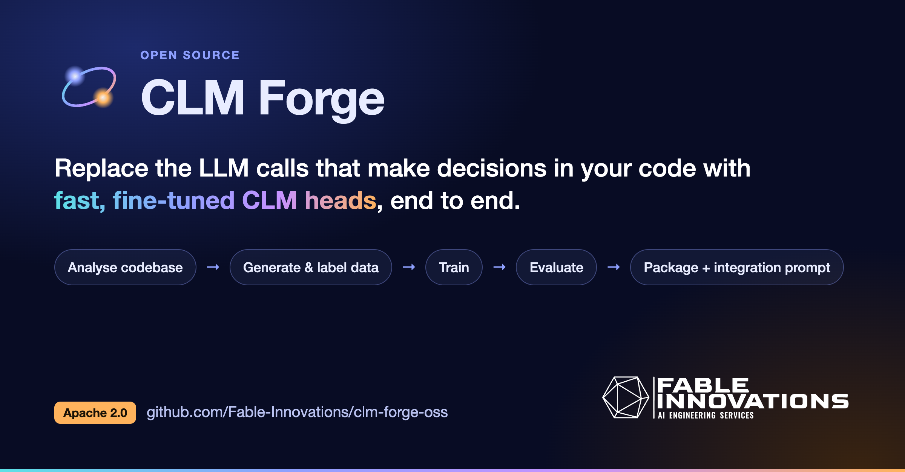

<p align="center">
  
</p>

## What it does

Point Forge at a repository. An agent finds a decision your code makes with an LLM (routing, triage,
intent, yes/no checks, guardrails, scoring, reranking) and proposes replacing it with a **CLM**: a frozen
encoder plus a small trained head ([CLM-v0.1-8B](https://huggingface.co/Contrastive-LM/CLM-v0.1-8B) is the
reference). Accept the proposal and Forge curates data, trains the head locally, evaluates it against baselines,
and ships a pip package with an `INTEGRATION.md` a coding agent can apply. If nothing fits, it says so.

- **The model proposes, the rules decide.** A state machine owns every transition; the agent can't accept its own
  proposal or ship a head that misses the gate.
- **Your data first.** Drop `.csv`/`.tsv`/`.jsonl` exports in `clm_data/` in the target repo; real rows are
  preferred for test, and generated rows are shaped on them.
- **Labelling.** Unlabelled real rows are labelled by an agent by default, or by you on the Labelling page.
- **Autopilot.** Keeps experiments, or head sets you train elsewhere (through an adapter), retrained on a
  schedule, with every decision journalled.
- **Local and careful.** One model job at a time, memory-budgeted; the API listens on 127.0.0.1 only.

## Requirements

- macOS on Apple Silicon (MLX), Python 3.12 with [uv](https://docs.astral.sh/uv/), Node 20.19+
- One LLM provider: a Claude or Codex subscription login, an OpenAI-compatible API key, or Ollama

## Quick start

```bash
./start.sh          # http://127.0.0.1:8765
./start.sh --dev    # with Vite hot reload on :5173
```

Everything Forge writes (database, settings, projects, packages, caches, logs) goes to `output/`, which is
gitignored. `FORGE_DATA` moves it; `FORGE_PORT` changes the port.

## Tests

```bash
cd backend && uv run pytest -q -m 'not model_loading'
cd frontend && npm run typecheck && npm test
```

## Docs

- [docs/GUIDE.md](docs/GUIDE.md): architecture, pipeline, your own data, labelling, autopilot and head-set
  presets, providers, encoders and memory
- [SPEC.md](SPEC.md): the contract between the parts, including the REST API and the autopilot adapter contract
- [backend/headset_presets.example.json](backend/headset_presets.example.json): an example head-set preset

## License

[Apache License 2.0](LICENSE). Attributions in [NOTICE](NOTICE). Built and maintained by
[Fable Innovations](https://fableinnovations.com); the Fable Innovations name and logo are not covered by the
license.
